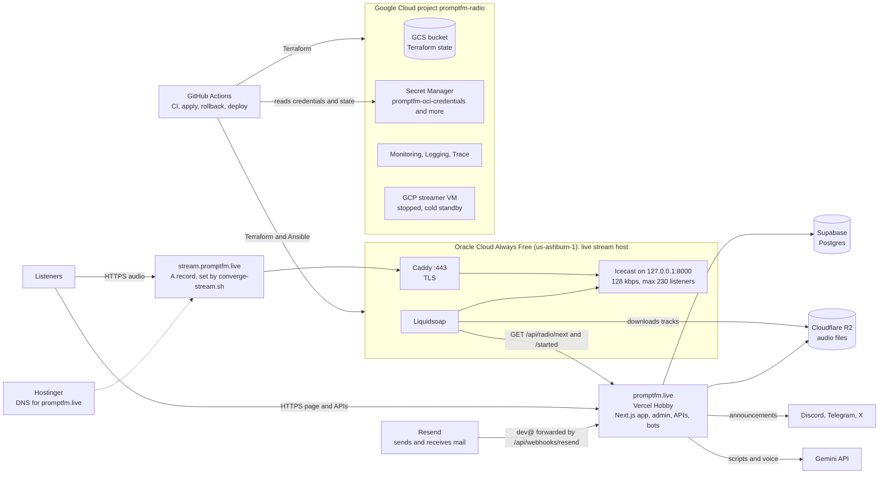
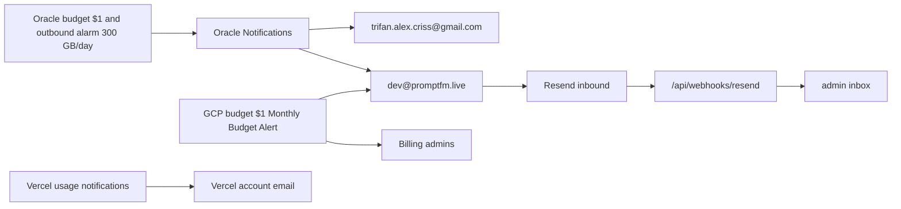

# PromptFM infrastructure: how it fits together

Everything runs on free tiers. This page shows the layout, what each system is used for, which commands still apply, how to switch the stream between Oracle and GCP, what to do when Oracle stops, and which alert emails to look for.

- Costs and guardrails per provider: [zero-cost-policy.md](zero-cost-policy.md)
- The Oracle host in detail: [oracle-always-free-streamer.md](oracle-always-free-streamer.md)

---

## 1. Diagram



Who sends alerts:



---

## 2. What we use for what

| System | Used for | Cost |
| :--- | :--- | :--- |
| **Oracle Cloud** (AMD micro VM, us-ashburn-1) | **Serves the live audio stream**: Caddy, Icecast, Liquidsoap. Terraform in `infra/terraform-oci`, deploy with Ansible | $0 (Always Free, quota-capped) |
| **Google Cloud** project `promptfm-radio-1793623670` | Terraform **state** (GCS), **Secret Manager** (Oracle credentials and deploy key, database URL, Hostinger token), Monitoring/Logging/Trace dashboard, the budget alert. The streamer VM is **stopped**: a cold standby for the stream | $0 while the VM stays stopped |
| **Vercel** (Hobby) | The Next.js app: web player, `/admin`, `/api/*`, bot webhooks, MCP, the daily news cron | $0 (deploy gate protects the free CPU hours) |
| **Supabase** | Postgres database | $0 |
| **Cloudflare R2** | Audio files and voice drops (free egress) | $0 |
| **Hostinger** | Domain and DNS for `promptfm.live` (the `stream` record points at the active host) | domain bundle |
| **Resend** | Sends app email and receives `dev@` and `contact@`, forwarded by the app to the admin inbox | $0 |
| **GitHub** | Repo, Actions (CI, Terraform apply, rollback, deploy, secret rotation), Pages (docs), project board | $0 |
| **Gemini API** | Scripts, voice drops, search embeddings | $0 (free key) |

The audio stream is the only thing that moves between Oracle and GCP. Everything else stays put.

---

## 3. Which commands still apply

| Command | Talks to | Works now? |
| :--- | :--- | :--- |
| `npm run promptfm -- now / next / queue / say / dj / news / weather / broadcast / ads / upload ...` | The app on Vercel, Supabase, R2 | Yes, unchanged |
| `npm run promptfm -- listen` | `stream.promptfm.live` | Yes, follows the DNS record |
| `npm run promptfm -- dns status / diff / apply / snapshot` | Hostinger | Yes. `dns status --strict` now fails only if `stream` points at the GCP VM |
| `npm run promptfm -- tag infra / infra-rollback` | Git tags | Yes, see section 4 |
| `npm run promptfm -- stream start / stop / status youtube\|tiktok` | The ffmpeg RTMP controller | **No, on either host today.** The controller is not deployed on Oracle (the 1 GB micro VM cannot encode video) and it was not running on GCP at the cutover. The admin "Live Streams" tab is the same. It needs a host with CPU, such as the Arm VM when Oracle has capacity |
| `infra/converge-stream.sh` | Terraform (GCP VM), Ansible (Oracle), Hostinger | Yes: the one command that moves the stream |
| `infra/ansible/deploy-oci.sh` | Oracle VM over SSH | Yes. The key comes from Secret Manager |
| `npm run promptfm -- ansible` (IAP to GCP) | The GCP VM | Not used any more. The GCP stack is started, not redeployed, so no second copy is created |
| `ssh ubuntu@<oracle ip>` | Oracle VM | Yes. Find the IP with `terraform -chdir=infra/terraform-oci output public_ip` |
| `gcloud compute ssh promptfm-streamer ...` | GCP VM | Only while the VM is running |
| Workflows: **Apply Infrastructure**, **Rollback Infrastructure**, **Apply Terraform (Oracle streamer)**, **Deploy Streamer (Oracle)**, **Rotate Secret** | GitHub Actions | Yes, see section 4 |

---

## 4. Switching the stream between Oracle and GCP

One file decides where the stream is served: [`infra/stream-host`](../infra/stream-host) holds `oracle` or `gcp`. Applying a commit makes everything match that word.

`infra/converge-stream.sh` does the work, and its **order** keeps two streamers from ever being on air together (two would consume the live queue twice and double every Discord and Telegram post):

| Step | Switching to `gcp` | Switching to `oracle` |
| :--- | :--- | :--- |
| 1. quiesce | Oracle goes to standby (loops the fallback track, never calls the API) | nothing |
| 2. Terraform | the GCP VM starts and its public 80/443 rule is created | the GCP VM stops and the 80/443 rule is removed |
| 3. serve | start the containers already on the GCP VM, point `stream` at its **new** IP, check the stream | check GCP is stopped, Oracle on air, point `stream` at Oracle, check the stream |

Every step is safe to repeat. If a run fails halfway, run the same command again.

### Tags

Tags are named `promptfm-infra/<version>-<short sha>`. Each one is a snapshot of the whole infrastructure, including `infra/stream-host`.

| Tag | Where it points | Stream host | How it is used |
| :--- | :--- | :--- | :--- |
| `promptfm-infra/0.3.0-<sha>` | the commit on `main` after PR #151 | `oracle` | the normal release. Pushing it applies it |
| `promptfm-infra/0.2.0-<sha>` | a commit made from `main` with `infra/stream-host` set to `gcp` | `gcp` | the rollback snapshot. It is applied by hand |
| `promptfm-infra/0.1.0-9b8127b` | the old pre-switch commit | n/a | **cannot be applied**: it predates `converge-stream.sh` and its DNS file is wrong |

Make the two tags after PR #151 merges:

```bash
# release: the stream on Oracle
git switch main && git pull
npm run promptfm -- tag infra --version 0.3.0      # pushes promptfm-infra/0.3.0-<sha>, which applies it

# snapshot: the stream on GCP, kept for rollback. Not on main, so pushing it applies nothing
git switch -c infra/stream-gcp main
echo gcp > infra/stream-host
git commit -am "chore(infra): snapshot where GCP serves the stream"
npm run promptfm -- tag infra --version 0.2.0      # pushes promptfm-infra/0.2.0-<sha>
git switch main
```

A tag whose commit is not on `main` is **not** applied automatically, and neither is a `promptfm-infra/rollback-*` tag. That is what makes the snapshot safe to create.

### Move the stream

- **Back to Oracle, or to any tag:** Actions, **Rollback Infrastructure**, `target_ref` = `promptfm-infra/0.3.0-<sha>`.
- **To GCP:** the same workflow with `target_ref` = `promptfm-infra/0.2.0-<sha>`.
- **From a laptop, in an emergency:** `infra/converge-stream.sh gcp` or `infra/converge-stream.sh oracle`.
- After a switch to GCP, the committed DNS file still lists the Oracle IP. That is fine: the script sets the `stream` record from the live IP of the active host.

---

## 5. Runbook: Oracle stopped working

**1. Confirm it.**

```bash
curl -I https://stream.promptfm.live/stream.mp3                       # expect HTTP 200
curl -s https://stream.promptfm.live/status-json.xsl | head -c 300      # expect a title and listeners
ssh ubuntu@<oracle ip> 'sudo docker ps; uptime'
```

Also look at the Oracle [instance page](https://cloud.oracle.com/compute/instances?region=us-ashburn-1): is it running, or was it reclaimed?

**2. Fix it on Oracle first. This keeps the cost at $0.**

| Symptom | Fix |
| :--- | :--- |
| Containers stopped | `ssh ubuntu@<ip>` then `cd /opt/promptfm/streamer && sudo docker compose up -d` |
| Config drift or a bad deploy | Run **Deploy Streamer (Oracle)**, or `infra/ansible/deploy-oci.sh` |
| Stuck in standby (silence or the fallback loop) | `infra/ansible/deploy-oci.sh -e liquidsoap_script=radio.liq` |
| VM stopped | Start it in the Oracle console, or `terraform apply` in `infra/terraform-oci` |
| VM reclaimed or deleted | `terraform apply` in `infra/terraform-oci` (or `retry-apply.sh` on "Out of host capacity"), then deploy |
| CPU choking (check Metrics Explorer) | Lower `max-listeners` in `deploy/streamer/icecast.xml` and redeploy |

**3. Last resort: switch to GCP.**

Run **Rollback Infrastructure** with the `0.2.0` snapshot tag, or `infra/converge-stream.sh gcp`. Two things to know:

- Tag names are labels for snapshots. There is no real `v0.2.0` of the old setup, because the old commit cannot be applied (section 4). The `0.2.0` snapshot is today's code with the stream host set to `gcp`.
- The GCP VM gets a **new** public IP when it starts. The script reads it and points DNS at it.

**4. This breaks the $0 goal. Keep it short.**

GCP only includes 1 GB/month of outbound traffic. One listener connected around the clock is about 41.5 GB a month, which at roughly $0.12/GB is about **$5 a month, or $0.17 a day**.

| Listeners on GCP | Rough cost per day |
| :--- | :--- |
| 1 | $0.17 |
| 5 | $0.83 |
| 20 | $3.30 |
| 100 | $17 |

- Treat the GCP stream as a few hours of emergency cover, not a place to stay. The `$1 Monthly Budget Alert` emails at 50%, 90%, 100% and 150% of $1.
- To cap the cost, lower `<max-listeners>` and `<clients>` in the GCP VM's `icecast.xml` (at `/home/trifan/streamer/icecast.xml`) and restart Icecast. Five listeners is about $0.83 a day.
- Go back as soon as Oracle works: **Rollback Infrastructure** with `promptfm-infra/0.3.0-<sha>`, or `infra/converge-stream.sh oracle`. That stops the GCP VM and removes its public 80/443 rule again.

---

## 6. Alert emails to look for

Subject lines vary, so look for the sender and topic.

| From | What it says | What to do |
| :--- | :--- | :--- |
| **Oracle Cloud Infrastructure Notifications** | A **subscription confirmation** with a Confirm link, once per address | **Click Confirm.** Until you do, no Oracle alert reaches that address. Check Gmail and the `dev@` forward |
| Oracle Notifications, budget | Actual spend reached **$1** | Open Cost Analysis. The quota policy should have blocked anything billable, so check it still exists |
| Oracle Notifications, alarm `promptfm-streamer-egress-daily` | The streamer sent more than **300 GB in a day** | Open Metrics Explorer (`oci_vcn`, `VnicToNetworkBytes`). Lower `max-listeners`, and check no video feed runs |
| Oracle Cloud | A notice that an **idle Always Free instance may be reclaimed** | Check CPU and traffic. Redeploy if it was reclaimed (section 5) |
| **Google Cloud Billing**: budget alert for `$1 Monthly Budget Alert` | Spend passed 50%, 90%, 100% or 150% of $1 | Open Billing reports. Stop the GCP VM if it is serving the stream (section 5) |
| **Vercel** | Usage near a limit, or a failed deployment | Check the Usage page, a runaway cron or polling. Turn these notifications on in Account Settings, Notifications |
| **GitHub Actions** | A failed **Apply Infrastructure**, **Deploy Streamer** or CI run | Open the run. A failed apply is safe to run again |
| **GitHub** security alerts and Dependabot | New findings. The Next.js upgrade is [#152](https://github.com/PromptFM/promptfm/issues/152) | Triage; critical and high first |
| **Hostinger** | Domain renewal and DNS notices | Renew in time: DNS and the stream hostname depend on it |

Both Oracle and GCP alerts go to `dev@promptfm.live` as well as your own address. That mailbox is received by Resend and forwarded to your inbox by the app. If the Vercel app is down, that forward stops, so keep the second address.

---

## 7. Is everything set?

| Item | Status |
| :--- | :--- |
| Stream served from Oracle, HTTPS valid, 128 kbps, UTF-8 title | Done |
| Hostinger `stream` record points at Oracle, the other 9 records untouched | Done |
| GCP VM stopped, public 80/443 rule removed, no reserved IPs | Done |
| Oracle quota policy, $1 budget, outbound alarm, listener cap | Done |
| Oracle and GCP budget emails also go to `dev@promptfm.live` | Done |
| Credentials and the deploy key in Secret Manager, used the same on a laptop and in CI | Done |
| **Confirm the two Oracle email subscriptions** (Gmail and `dev@`) | **You: pending** |
| **Turn on Vercel usage notifications** | **You: not set by the repo** |
| Merge PR #151, then make the `0.3.0` and `0.2.0` tags (section 4) | Pending the merge |
| The workflows run end to end in GitHub | Not yet run there: they can only run after the merge. Do one switch drill after tagging |
| Next.js upgrade for the 29 security findings | [#152](https://github.com/PromptFM/promptfm/issues/152) |
| Watch micro VM CPU and idle-reclaim notices for the first week | Open |
| YouTube and TikTok video feeds | Not deployed on either host |
